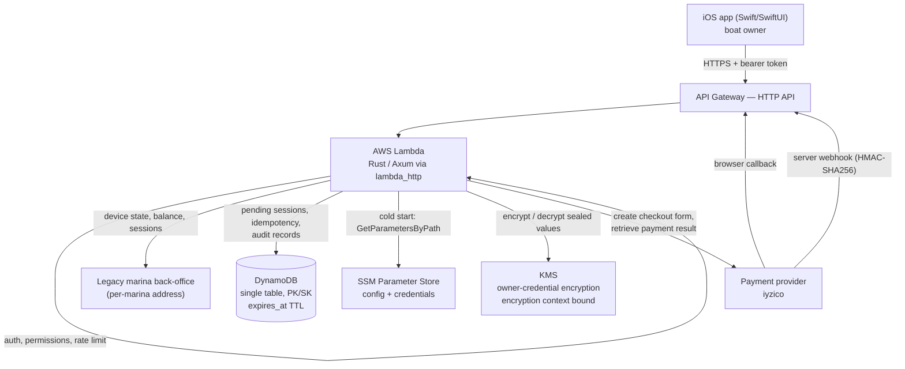

# Marina middleware — architecture case study

> **What this repository is:** a written case study of the backend middleware I designed and shipped for a
> marina management platform. It documents the *problems, constraints and decisions* — not the production code,
> which belongs to my employer and stays private.
>
> **What this repository is not:** a copy of client source. No client code, no infrastructure identifiers, no
> credentials, no customer data. See [docs/what-is-not-here.md](docs/what-is-not-here.md).
>
> The `reference-impl/` crate is independent code I wrote to demonstrate the two patterns that carry the most
> risk in this system: **HMAC-verified webhooks** and **idempotent payment state**. It is not the production code.

---

## The problem

Marina berths have utility pedestals: an electricity and a water connection per berth that a boat owner plugs
into. Historically these are physical, un-metered, and switched by marina staff. This project is the software
layer that turns them into something a boat owner can control from a phone:

- show the state of the pedestal at *my* berth,
- switch electricity and water on and off,
- meter consumption and bill it,
- take payment for top-ups, through a local payment provider,
- and do all of it against a **legacy marina back-office** that was not designed for mobile clients.

The interesting engineering is not the endpoints. It is that every request crosses a boundary between a phone, a
stateless cloud function, a legacy system of record, a payment provider, and a physical device that can be
unplugged mid-command.

## Constraints that shaped the design

| Constraint | Consequence |
|---|---|
| Each marina runs its own legacy back-office, at its own address | Requests are routed per marina; no single backend URL |
| The legacy backend keeps local wall-clock dates, offset from UTC | A UTC-offset correction layer in front of date handling |
| The legacy backend has no idempotency, no transactions, no locking | Idempotency has to be built *outside* it, in front of it |
| Payment provider delivers **both** a browser callback and a server webhook, sometimes duplicated, sometimes out of order | Two entry points must converge to exactly one balance update |
| Physical devices fail mid-command | State transitions have to be explicit and recoverable, not implicit |
| Cost sensitivity: an idle marina generates no traffic | Always-on compute is a poor fit; pay-per-invocation is a good fit |
| Secrets must never sit in environment files or images | Config and credentials resolved at cold start from a managed store |

## Architecture



Everything marked as a runtime dependency is resolved at cold start; the handler path is pure request handling.

## Key decisions

Five decision records, in the order they mattered:

| ADR | Decision | Why it mattered |
|---|---|---|
| [0001](docs/adr/0001-serverless-over-ecs.md) | Move from ECS/ALB to Lambda behind HTTP API | Removed 100% of fixed compute cost for a workload that is idle most of the day |
| [0002](docs/adr/0002-idempotency-outside-the-legacy-system.md) | Own the idempotency boundary in the middleware, not in the legacy backend | The legacy system has no transactions; retries were already double-charging |
| [0003](docs/adr/0003-dynamodb-ttl-is-not-a-correctness-mechanism.md) | Treat DynamoDB TTL as cleanup, and expire on read | TTL deletion is delayed by design; trusting it silently served expired sessions |
| [0004](docs/adr/0004-hmac-webhook-verification.md) | Verify every webhook signature in constant time, before parsing trust into it | The webhook is an unauthenticated public endpoint that moves money |
| [0005](docs/adr/0005-secrets-and-encryption-context.md) | Config from SSM, sealed values from KMS with a bound encryption context | Removed plaintext credentials and made ciphertext non-transplantable |

## What I would do differently

Honest limits of the current design, because a case study without this is marketing:

- **The legacy backend is still the system of record.** Idempotency lives in front of it, which means a crash
  between "legacy write succeeded" and "idempotency record committed" is a real (if narrow) window. A proper fix
  is an outbox/claim record written *before* the upstream call — partially done for payments, not for every path.
- **Per-marina routing is configuration, not discovery.** Adding a marina is a config change. At a few dozen
  marinas that is fine; at hundreds it needs to become data.
- **The observability story is thin.** Structured logs, but no request-scoped correlation ID threaded through the
  legacy backend, so a failed payment is traced by timestamp rather than by identity.
- **Single table for everything.** Convenient and cheap at this scale; it will need a deliberate access-pattern
  review before the audit records grow.

## Repository layout

```
README.md                     this file
docs/architecture.md          component view + request flows, in more detail
docs/what-is-not-here.md      what was deliberately excluded, and why
docs/adr/                     the five decision records
reference-impl/               independent Rust demo of the webhook + idempotency patterns
```

## Running the reference implementation

```bash
cd reference-impl
cargo test
```

The demo has no external dependencies: an in-memory store stands in for DynamoDB, and a mock provider produces
signed webhooks. See [reference-impl/README.md](reference-impl/README.md).

## License

`reference-impl/` is MIT licensed. The documentation is © Ahmet Can İzgi. The production system described here
is the property of my employer and is not included in any form.
